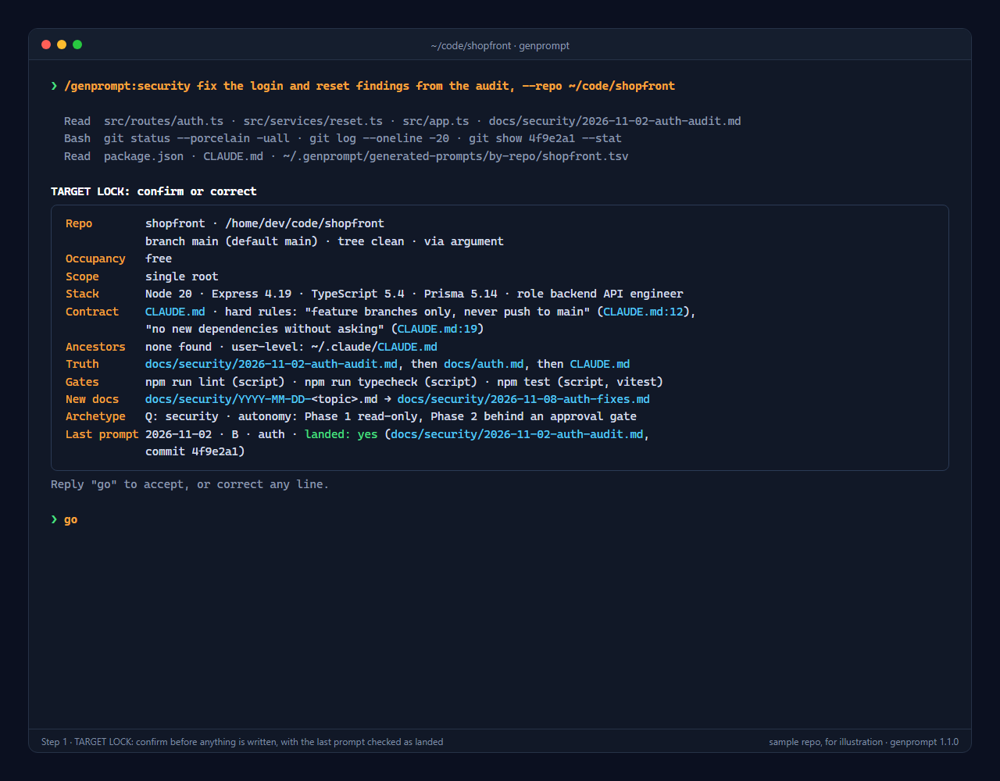
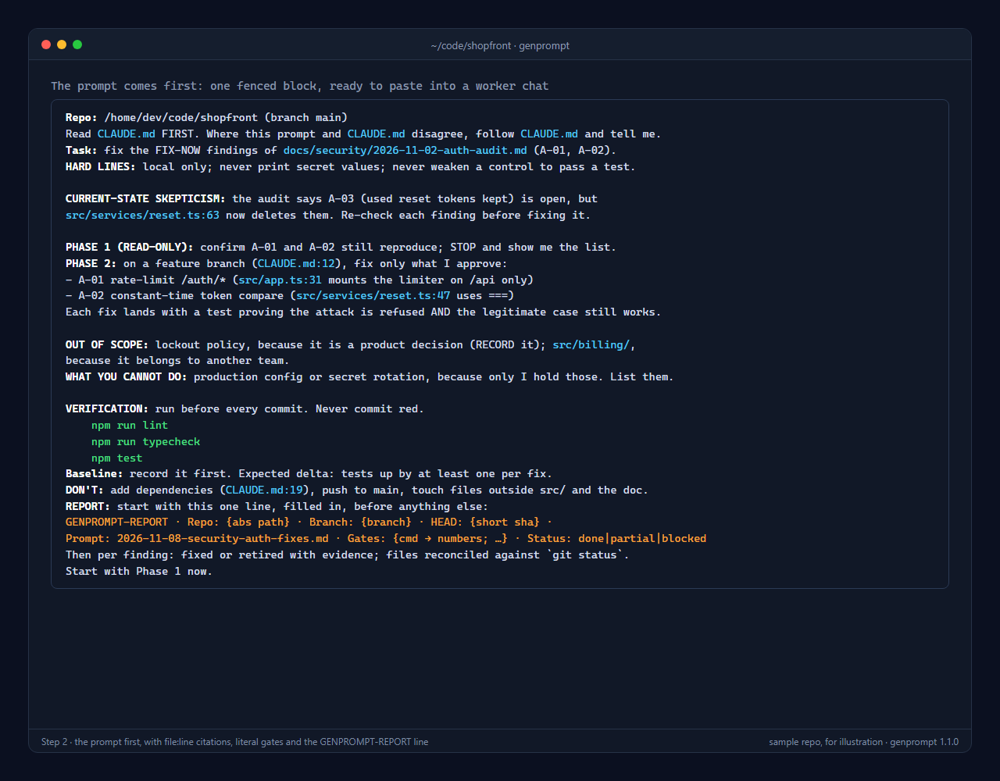
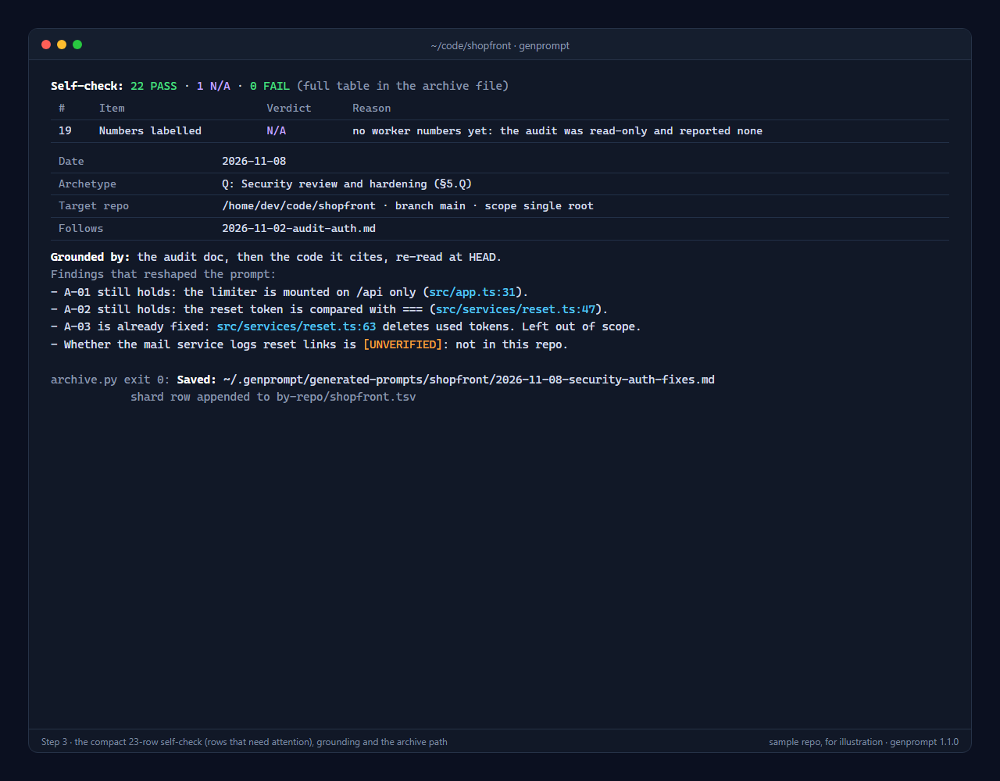

_ prompt mark" width="96" align="right">

# genprompt

A Claude Code plugin that writes prompts for Claude Code.

You work with two chats. A **generator** chat runs genprompt: it reads your repo (read-only) and
writes one grounded, ready-to-paste prompt. A **worker** chat, open on the same repo, does the
work and ends with a stop-report. Paste that report back into the generator, and it writes the
next prompt.

```text
/genprompt:<command>  →  TARGET LOCK (confirm with "go")  →  one fenced prompt + self-check
        ↑                                                            │ paste into the worker chat
        └────────── paste the worker's stop-report (= :next) ←───────┘
```

Every prompt it writes:
- is anchored to the repo, the branch and the sub-project it targets
- follows the repo's own `CLAUDE.md` / `AGENTS.md` contract, and says so when it must deviate
- cites `file:line` for every load-bearing instruction, and marks anything it could not check as
  `[UNVERIFIED]`
- carries literal quality gates (lint, typecheck, test, build) taken from the repo's real scripts
  or from tools it can prove are installed, never invented ones
- ends with a stop-list, a definition of done and a report spec, so the worker's report can be
  checked
- is followed by a 23-row self-check with a verdict and a reason on every row: in chat, a verdict
  line plus the rows that need attention; in the archive, the full table

## What it looks like

A security prompt for a made-up sample repo, `shopfront`. Every repo detail in these screenshots is
invented; the structure is the real output.

**1. The TARGET LOCK.** genprompt reads the repo and shows what it found, including whether the
last prompt actually landed. Nothing is written until you reply `go`.



**2. The prompt.** It prints first: one fenced block to paste into the worker chat, with
`file:line` citations, literal gates, and a report spec that starts with a `GENPROMPT-REPORT` line.



**3. Self-check and grounding.** A one-line verdict for the 23-row self-check and only the rows that
need attention (the full table goes to the archive file), then the findings that shaped the prompt
and the archive path.



## Install

In Claude Code:

```text
/plugin marketplace add Sh0aib-Ja0allah/genprompt
/plugin install genprompt@genprompt
```

Then restart Claude Code, or run `/reload-plugins`, and type `/genprompt:help`.

**Requirements**
- Claude Code with plugin support
- `git` on PATH. On Windows, Git for Windows, whose Git Bash is what Claude Code's Bash tool uses.
- Python 3, only for `/genprompt:doctor` (the integrity check). Nothing else needs it.

## Quick start

**First run:** after installing, run `/genprompt:doctor --suite` once. It checks that the installed
rules are complete and consistent, and it needs nothing but Python 3.

**Start here:** `/genprompt:auto <what you want>` picks the command for you. Six core commands
cover most work:

| I want to… | Command |
|---|---|
| build a feature or one change set | `/genprompt:slice` |
| fix bugs that are already confirmed | `/genprompt:fix` |
| commit and push finished work | `/genprompt:commit` |
| rule on findings or change a prompt already sent | `/genprompt:approve` |
| rebuild one screen, component or module | `/genprompt:redesign` |
| continue from a worker's stop-report | `/genprompt:next` (or just paste the report) |

Occasional, when the job calls for them:

| I want to… | Command |
|---|---|
| understand a repo I haven't worked in | `/genprompt:onboard` |
| review what the worker just committed | `/genprompt:review` |
| find out why a bug happens | `/genprompt:investigate` |
| deal with something broken in production now | `/genprompt:hotfix` |
| plan work before any code | `/genprompt:plan` |
| not sure | `/genprompt:help <your goal>` (it ends with the `:auto` line to run) |

A typical loop on a new repo: `:onboard` → `:slice` → `:next` → `:review` → `:commit`.

Open Claude Code **in the repo you want to work on** (or pass `--repo <path>`):

```text
/genprompt:auto review what the worker just committed              ← picks the command
/genprompt:help I need to review what the worker just committed    ← which command fits?
/genprompt:onboard                                                  ← first contact with a repo
/genprompt:slice Slice S3, scope: report builder column whitelist   ← build something
<paste a worker stop-report>                                        ← the next prompt
/genprompt:history                                                  ← what have we sent this repo?
```

The first answer is always a **TARGET LOCK**: the repo, branch, stack, contract, gates and any open
questions, all derived from the repo. Reply `go` (or correct a line) and you get the prompt. Copy
it into a second Claude Code chat opened on the same repo.

Opening Claude Code inside the target repo is the smooth path: its read-only git commands are
pre-approved there. With `--repo` pointing at another folder, Claude Code asks you to approve each
`cd <repo> && git …`. That is Claude Code's own safety check for running git in a directory other
than the one you opened.

Not sure which command? `/genprompt:auto <what you want>` picks one for you.

## Commands

Core: `:auto`, then `:slice` · `:fix` · `:commit` · `:approve` · `:redesign` · `:next`. The rest
are occasional; the picker in [archetypes/README.md](archetypes/README.md) groups them the same
way.

| Stage | Commands |
|---|---|
| Understand | `:onboard` · `:audit` · `:investigate` · `:review` · `:security` |
| Decide | `:plan` · `:design` · `:approve` |
| Build | `:slice` · `:roadmap` · `:fix` · `:redesign` · `:greenfield` · `:kickoff` · `:test` · `:perf` · `:upgrade` · `:cleanup` · `:hotfix` · `:docs` |
| Ship | `:commit` · `:release` |
| Continue | `:next` (`--from <session>`: EXPERIMENTAL) · `:resume` |
| Any | `:auto` (picks the archetype from your request) |
| Utilities | `:help` · `:history` · `:doctor` · `:profile` · `:learn` |

Each command is `/genprompt:<name>`. The "I want to… → use…" picker is in
[archetypes/README.md](archetypes/README.md), and the full grammar is in
[guide/08-grammar.md](guide/08-grammar.md).

**Modifiers** (on any prompt command): `--repo <name|path>`, `--go` (skip the lock wait),
`--attended` / `--unattended`, `--dry-run` (archive nothing), `--brief`, `--follows <file>`,
`--send <session>` (EXPERIMENTAL: also deliver the prompt to that Claude session; asks first),
`--verbose` (full self-check table in chat). Per command: `--split <N>` (`:plan`, `:roadmap`:
parallel worker prompts with disjoint file ownership, plus one merge prompt), `--chat-only`
(`:review`), `--verify` and `--pr` (`:commit`: verify first; branch, push and open a PR, each
approved by you), `--readonly-phase` (`:security`, `:perf`: the read-only first phase only),
`--from <session>` (`:next`, EXPERIMENTAL: read the report that session sent here). The hand-run
checks for `--send` and `--from` follow after 1.3.0.

## Where your files go

genprompt never writes into your repos. Everything it saves goes to one folder in your home
directory:

```text
~/.genprompt/
  generated-prompts/          every prompt it emitted, per repo, with its self-check
    by-repo/<repo>.tsv        one row per prompt: the history /genprompt:history reads
    by-repo/<repo>.profile.md a cached profile of the repo (stack, contract, branch)
    <repo>/<date>-<cmd>-<slug>.md
  local-rules.md              your personal rules (optional, written by /genprompt:learn)
```

This folder is outside the plugin, so plugin updates and reinstalls never touch it. It stays on
your machine. genprompt sends nothing anywhere, but the archived prompts do contain details of your
repos, so treat the folder like the repos themselves.

## Teaching it your rules

When a turn produces a lesson, such as "Composer is not on PATH on this machine; use
`php ~/bin/composer.phar`" or "never trust the ✅ marks in our delivery register",
run:

```text
/genprompt:learn <the rule>
```

It checks whether the suite already covers the rule, shows you the exact text it will add to
`~/.genprompt/local-rules.md`, and writes it only after you say yes. Every command reads that file,
and your rules win over the suite's where they conflict. If the rule would help everyone,
`:learn` also prints a ready-to-paste issue for this repository.

## Guarantees

- **Read-only on every repo.** It reads files and runs read-only git (`status`, `log`, `diff`,
  `show`, …). It never runs builds, tests, installs or migrations. It checks a worker's claims by
  reading commits, diffs and files.
- **Pre-approved tools are narrow.** Each command pre-approves Read/Glob/Grep, read-only git, a few
  listing commands, and writes under `~/.genprompt/` only. Anything else asks you first.
- **Grounded.** Every load-bearing instruction cites `file:line`, and anything unverified is marked.
- **The repo's contract wins.** Branching, deploy and push rules come from the repo's `CLAUDE.md`.
  Release and deploy steps need your approval for each action.

## Without the plugin

[BOOTSTRAP.md](BOOTSTRAP.md) has a copy-paste block that turns any chat able to read local files
into a generator, using a clone of this repository.

**Also on Agensi.** genprompt is listed as a free skill on
[Agensi](https://www.agensi.io/skills/genprompt), a SKILL.md marketplace. The skill runs the same
rulebook, without the `/genprompt:` slash commands.

## Layout

| Path | What |
|---|---|
| `PROTOCOL.md` | The runtime steps, loaded by every command except help and doctor |
| `guide/` | The rulebook, split by section (§0–§12). Start at `guide/00-index.md` |
| `archetypes/` | One template per archetype, A–X, plus the picker |
| `stacks/stack-matrix.md` | Stack detection and role labels; routes to one gate ladder per ecosystem in `stacks/ladders/` |
| `utilities/` | Specs for help, history, doctor, learn and profile |
| `examples/` | Worked examples of strong blocks, for illustration only |
| `commands/` | The slash commands. Generated: do not edit by hand |
| `tools/build_shims.py` | Generates `commands/` from one table |
| `tools/doctor.py` | Integrity checker for the suite and your archive |
| `.claude-plugin/` | The plugin and marketplace manifests |
| `assets/` | The logo and the README screenshots |

## Contributing

Rule changes are welcome as issues or pull requests. To work on the suite:

```bash
git clone https://github.com/Sh0aib-Ja0allah/genprompt
cd genprompt
# edit the rules; if you add or rename a command, edit the tables in tools/build_shims.py, then:
python3 tools/build_shims.py
python3 tools/doctor.py --suite
claude plugin validate .
claude --plugin-dir .          # try your local copy without installing it
```

Keep the stability rules in [guide/00-index.md](guide/00-index.md) §12: archetype letters and
section numbers never change, because archived prompts cite them. Add a
[CHANGELOG.md](CHANGELOG.md) line for every rule change.

## License

[MIT](LICENSE)
